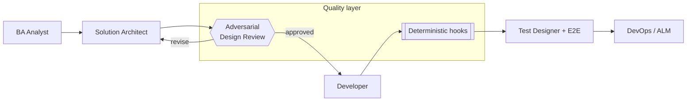

# Power Platform Agentic Delivery

[](https://github.com/mikhail-traitel/power-platform-agentic-delivery/actions/workflows/ci.yml)

A **delivery harness for AI-assisted Microsoft Power Platform work** - skills, hooks, review gates,
and a constraint catalog wrapped around a set of agents spanning the software development lifecycle
(business analysis, solution architecture, development, test, DevOps), with a quality layer that is
part **deterministic** and part **adversarial**. The harness is demonstrated end-to-end on a worked
example scenario; the Power Platform artifacts it governs live in your project, not in this repo.

The goal: make LLM-assisted Power Platform delivery **predictable and quality-gated**, instead of
fast but inconsistent.

> **What this repo is.** A public, client-free reference implementation of the *approach* -
> [Claude Code](https://docs.claude.com/en/docs/claude-code) agents, skills, rules, hooks, and
> deterministic scripts you can read, run, and adapt. The techniques are real; the code is written
> fresh and generic.
>
> **What this repo is not.** It is not a proprietary or client system, and it is not a Power
> Platform solution: there is no Power Fx, plugin, or solution file here - the harness is the
> deliverable, shown running against a worked example. Every rule, example, and constraint is
> generic and sourced from public Microsoft Learn documentation and general Power Platform practice.
> The example schema uses a neutral `sample_` prefix; my other repos model the same fictional
> Contoso events domain under an `evt_` publisher prefix - see
> [powerplatform-webresource-patterns](https://github.com/mikhail-traitel/powerplatform-webresource-patterns)
> and [power-platform-events-portfolio](https://github.com/mikhail-traitel/power-platform-events-portfolio).

## Why

LLM coding agents make Power Platform delivery fast, but on their own they are inconsistent: self-
review has a blind spot, run-to-run results vary, changes in one technology silently break another,
and a general model happily violates hard platform limits (delegation caps, column truncation,
publish-time validation). This pipeline puts a stage-agent on each SDLC phase and a two-substrate
quality layer around them.

## The pipeline



Each stage is a Claude Code subagent (`.claude/agents/`). The quality layer wraps them.

## What is in here

### 1. Adversarial design review (`.claude/skills/design-review/` + reviewers)

Gate a design before code exists. An orchestrator runs a deterministic pre-scan, three **fork-isolated
reviewers** (consistency, source-alignment, platform-correctness), then deterministic synthesis,
evidence-grounding, and verdict. The distinctive parts:

- **The verdict is computed, never judged** (`compute_verdict.py`) - the LLM finds defects; a script
  applies one fixed gate rule, so the same findings always produce the same verdict.
- **Evidence grounding by word-level LCS with demotion, not deletion** (`verify_evidence.py`) -
  each quote is matched inside a *local window* of the document (not the whole token stream, which
  would let a fabricated quote scavenge a chance subsequence). Fabricated quotes score low and get
  demoted one severity; paraphrased-but-real quotes survive; a human still sees what was
  down-weighted. (See ADR-004.)
- **Negative-space constraint coverage** - the platform reviewer checks what the design *fails to
  mention* against a catalog, not just what it says. (See ADR-005.)

All the scoring scripts are Python stdlib. A committed, end-to-end worked run over the sample - with
the non-deterministic LLM-reviewer stage captured as fixtures - lives in
[`examples/review-run/`](examples/review-run/) (verdict `REJECT`, a fabricated finding demoted and a
paraphrase kept), and `npm run test:review` re-derives its deterministic tail in CI to prove it stays
reproducible.

### 2. Deterministic authoring hooks (`.claude/hooks/`)

`PreToolUse` guards that enforce conventions before an edit lands:

- **Diff-aware regex** (`no-xrm-page.js`, `check-hardcoded-guid.js`) - block the *introduction* of a
  banned pattern, not its removal, so cleanups are never punished.
- **AST, context-sensitive** (`check-console-context.js`) - parses the file's *projected post-edit
  content* with acorn to enforce a rule a regex cannot express ("direct `console.*` allowed only
  inside the logging-bootstrap function"), diff-aware against the current file.
- **Context injection** (`inject-rules.js`) - streams the path-scoped rule file into the model at edit
  time.
- **Eval-integrity guards** (`eval-integrity/`) - agent-gated hooks so a reviewer agent cannot read
  the answer key or edit its own rubric. (See ADR-006.)

`npm install && npm run test:hooks` runs all of them (22 checks).

### 3. Fault-first test designer (`.claude/skills/test-designer/`)

Designs (never runs) test cases against an explicit fault model. Coverage comes from external
enumeration, not model recall; the runtime oracle is trimmed to `{equality, recency}` with count-delta
re-expressed as per-bucket equality (which catches compensating-error bugs a sum-oracle misses); an
input firewall stops the model transcribing the author's blind spots. (See ADR-007.)

### 4. Public Power Platform constraint catalog (`catalog/`)

A generic, MS-Learn-sourced catalog of hard platform constraints (delegation caps, column truncation,
view thresholds, plugin limits, deprecated APIs). Powers the review's constraint-coverage pass, and
useful on its own as a checklist. Numbers are documented defaults - verify against current MS Learn.

## Try it

```bash
npm install                 # acorn, for the AST hook
npm test                    # 22 hook checks + the review-pipeline determinism regression

# or run the pieces directly:
npm run test:hooks          # 22 hook checks
npm run test:review         # re-derive examples/review-run/ and assert it is unchanged

# see the deterministic review scripts run on a sample (see examples/review-run/ for the full run)
python .claude/skills/design-review/scripts/pre_scan.py examples/sample-design.md
```

## Maturity - honest status

This repo distills techniques proven on real Power Platform delivery into a clean, generic form,
written fresh. Components are at different maturity **as published here**:

| Component | Status in this repo |
|-----------|---------------------|
| Deterministic review scripts + hooks | Working and tested |
| Adversarial review skills (orchestrator + reviewers) | Working reference prompts |
| Constraint catalog | Working; grows over time |
| Test designer | Working reference prompt + schema |
| BA / architect / developer / test / devops stage-agents | Templates to adapt |

Any recall / variance / token-cost targets the approach aims for are **goals, not benchmarks published
here.**

## Repository layout

```
.claude/
  agents/     stage-agents + design-reviewer
  skills/
    design-review/       orchestrator SKILL + scripts/ (pre_scan, verify_evidence, synthesize,
                         compute_verdict, validate) + references/
    review-consistency/  reviewer prompt
    review-alignment/    reviewer prompt
    review-platform/     reviewer prompt (+ constraint-coverage pass)
    test-designer/       fault-first designer + references/
  rules/      path-scoped Power Platform conventions (public best practice)
  hooks/      diff-aware regex + AST hooks + eval-integrity guards + lib/ + config.json
  settings.json
catalog/      public Power Platform constraint catalog
docs/         architecture decision records (ADR-001..007)
examples/     a toy, generic scenario + a committed end-to-end review run (review-run/)
test/         hook test harness + review-pipeline determinism regression
.github/
  workflows/ci.yml   runs the hook checks + the determinism regression on every push/PR
```

## How this repo was built

With the pipeline it describes. The repo was built with [Claude Code](https://docs.claude.com/en/docs/claude-code),
dogfooding its own harness: the hooks guarded the edits, the deterministic scripts were regression-tested as
they were written, and the review discipline in `docs/` gated the design. I designed the architecture,
directed each piece, and verified every script, hook, and claim by running it. That is the point of the
repo - AI-assisted delivery is the subject, not a shortcut to hide.

## License

MIT - see [LICENSE](LICENSE).

## Provenance

The *ideas* come from applying agentic delivery to real Power Platform work. The *code* is original
work, built from scratch for this repo; it contains no proprietary code and no client data. Keep your
own client conventions in your own private configuration.
